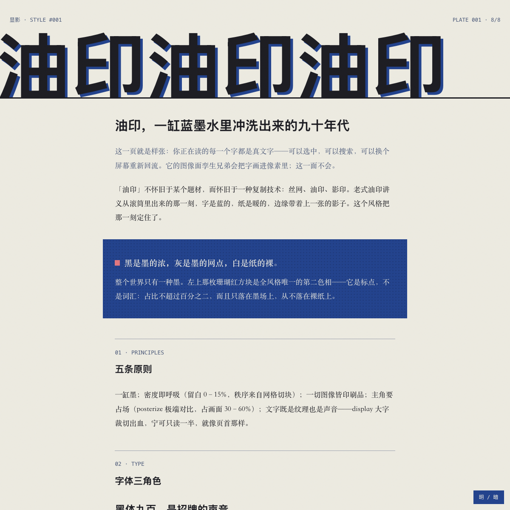
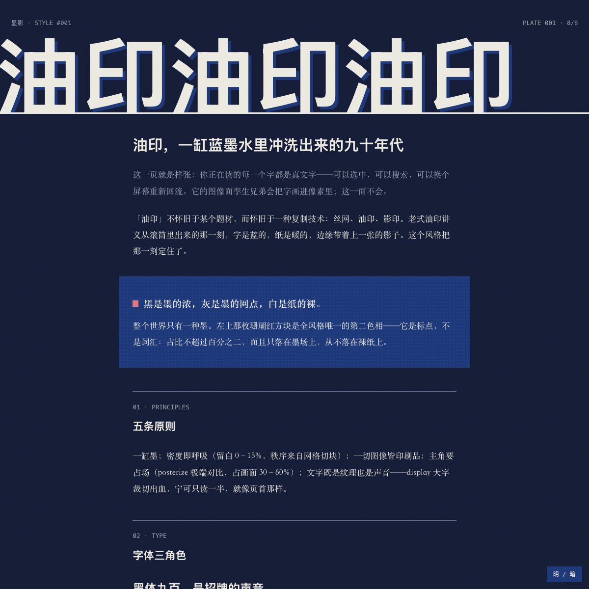
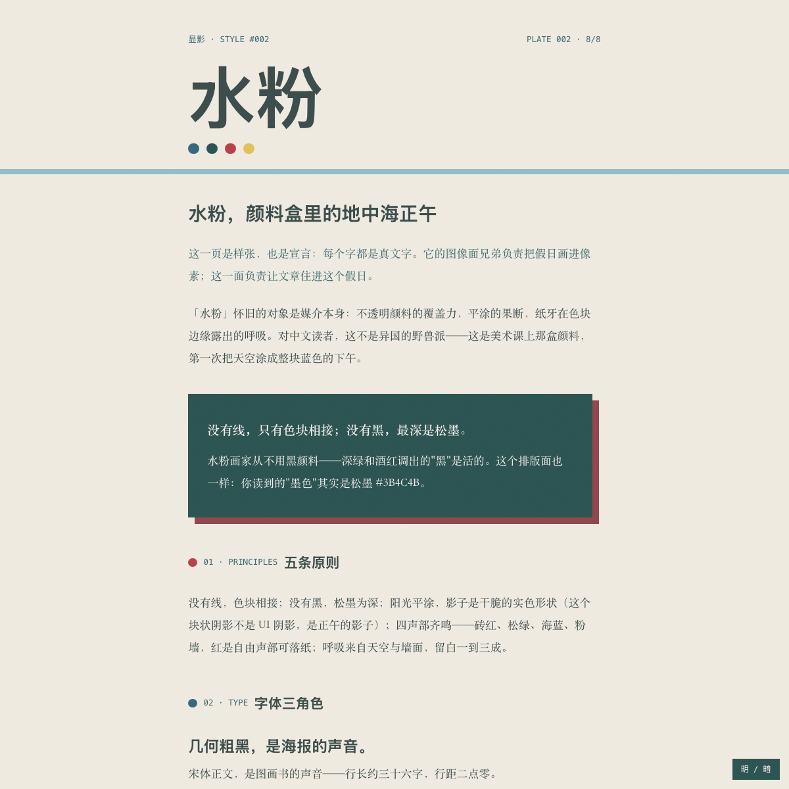
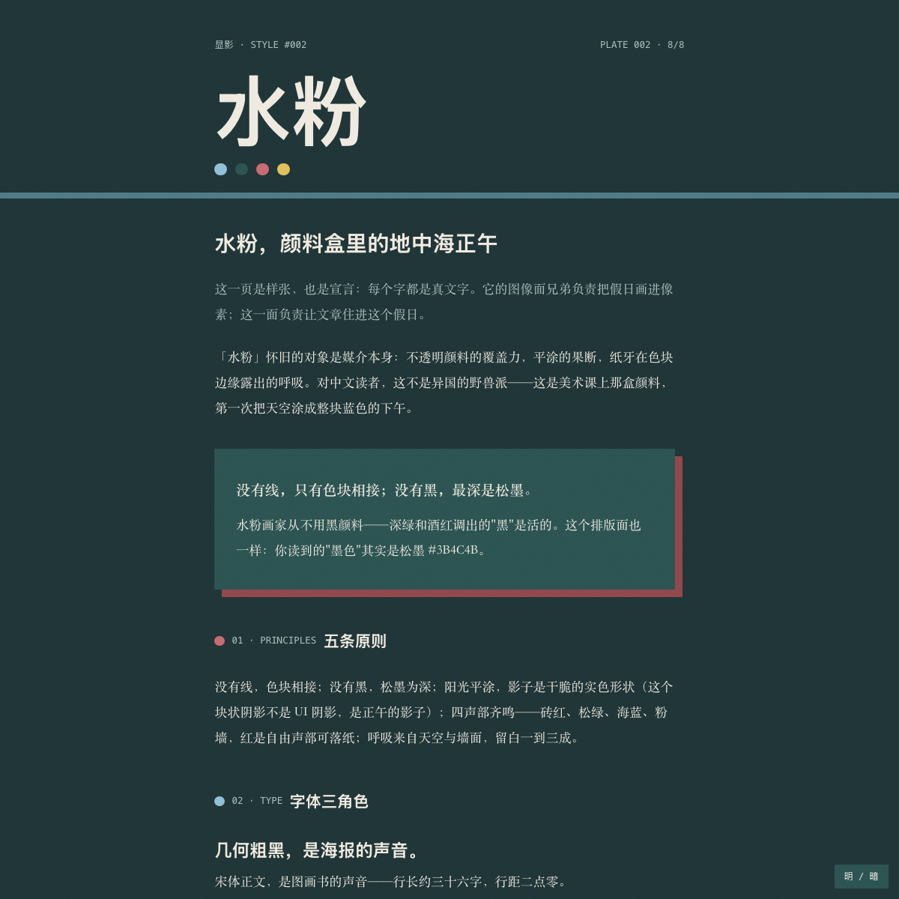
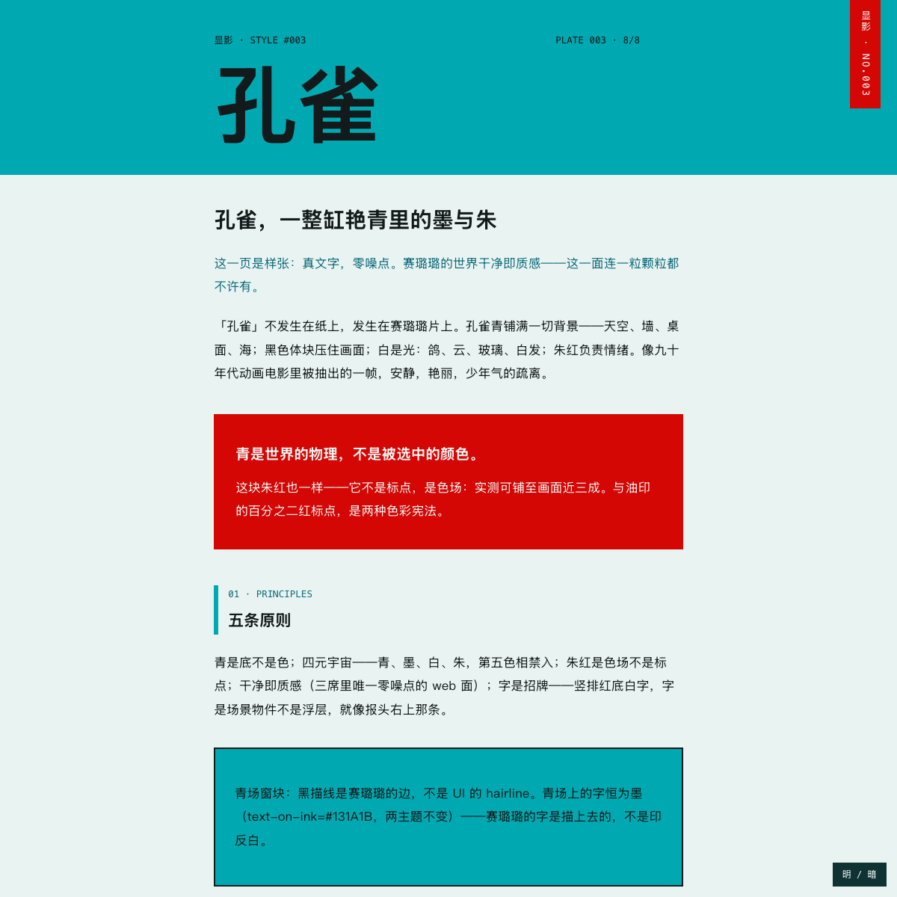
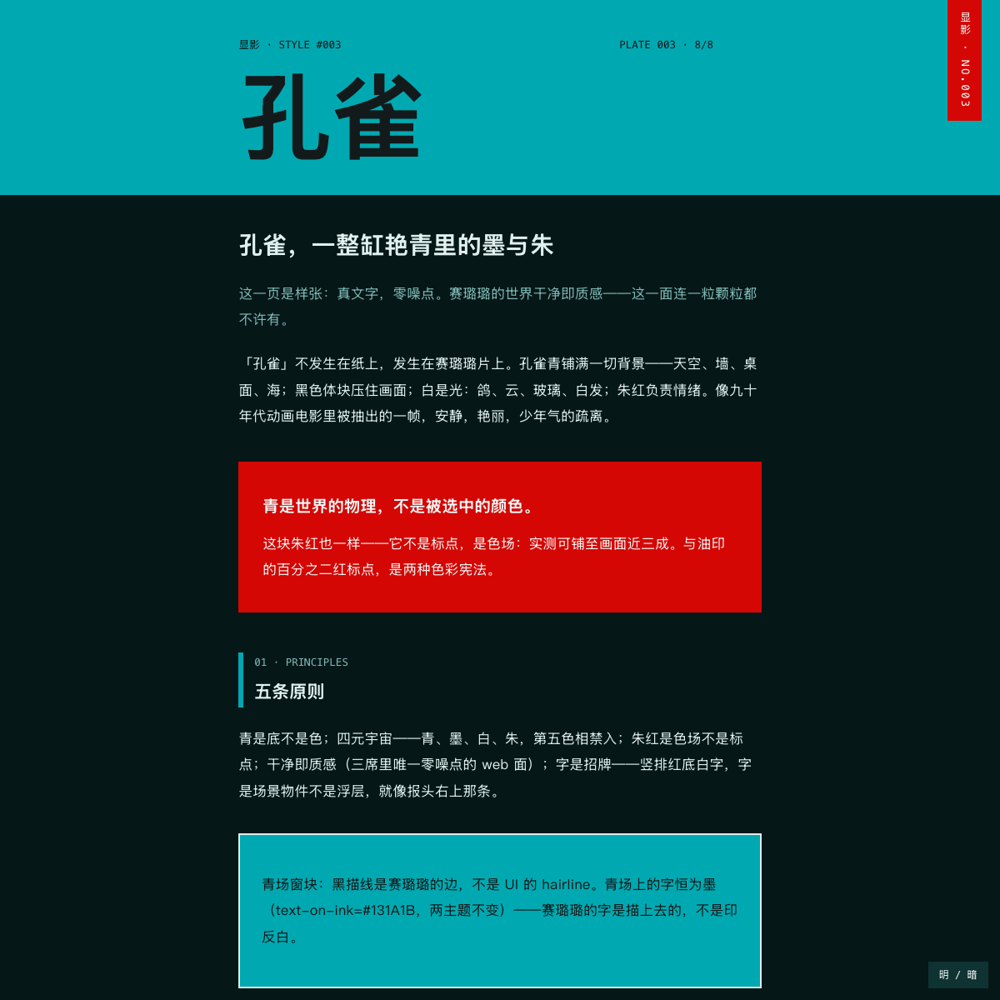

# 显影 / Xianying

**有出处的风格库。** 每一款 Style 都不是发明出来的，而是从一组经过八个固定探针题材反复验证的源图里**显影**出来的——附出生证：计算色板实测与提炼笔记，样图随席位更新。

每周显影一款。

## 样张

同一套 tokens，明暗两档。下面每张图在真实页面上都是可选中的真文本——样张用风格自己的排版面（article-face）渲染它自己的介绍。图像面（prompt-face）样图随席位陆续补入。

**001 油印 / Mimeo**

<p>
 
</p>

**002 水粉 / Gouache**

<p>
 
</p>

**003 孔雀 / Peacock**

<p>
 
</p>

## 一款 Style 的构成（两张脸）

```
styles/NNN-<名>/
├── style.json        # 角色化 design tokens（实测值，light/dark 双档）+ prompt_fragment
├── SPIRIT.md         # 神（一句话气质）· 意（设计原则）· 形（手法）· 反模式区（有否决权）
├── provenance/       # 出生证：measure→pattern→taste 提炼笔记（样图随席位补入）
├── prompt-face.md    # 图像面：把任意主题编译成该风格的图像生成 prompt
├── article-face.css  # 排版面：吃 tokens 的文章模板（中文排版第一公民）
├── specimen.html     # 样张：用该风格渲染它自己的介绍
└── (验证: python3 tools/verify_style.py styles/NNN-<名>)
```

## 目录

| # | 名 | 神 | 状态 |
|---|---|---|---|
| 001 | 油印 / Mimeo | 一缸蓝墨水里的九十年代街头记忆 | v0-draft |
| 002 | 水粉 / Gouache | 地中海正午的水粉写生——颜料盒里的假日 | v0-draft |
| 003 | 孔雀 / Peacock | 孔雀蓝釉色的赛璐璐世界——一整缸艳青里的墨与朱 | v0-draft |

命名轴 = 复制的材料：油印（工艺）· 水粉（媒介）· 孔雀（釉色）。

## 许可

代码 / tokens / 文档：MIT（见 LICENSE）。
provenance 源图：仅展示授权，不随 MIT 授出（见 LICENSE-ASSETS.md）。
